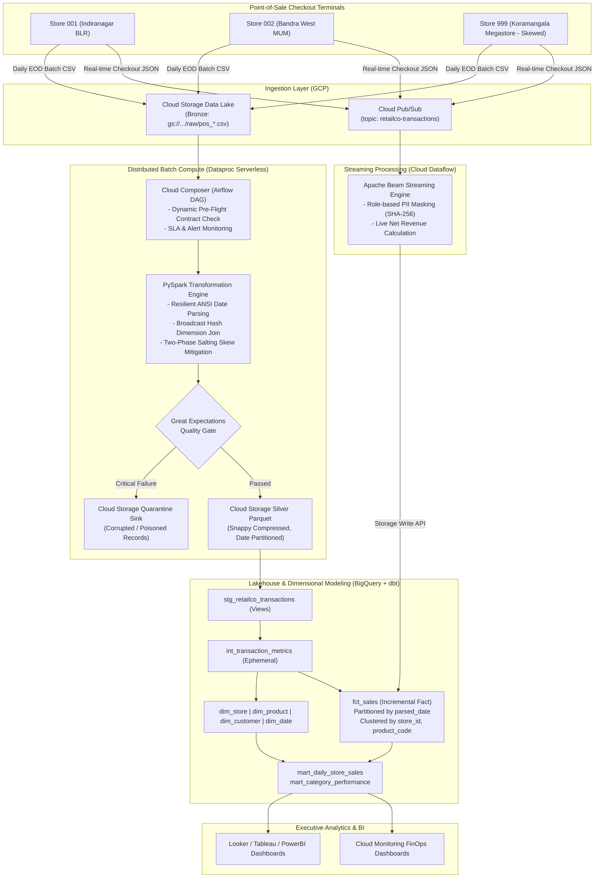

# RetailCo Enterprise POS Data Engineering Platform on GCP

[](https://www.python.org/)
[](https://cloud.google.com/)
[](https://cloud.google.com/bigquery)
[](https://cloud.google.com/dataproc-serverless)
[](https://airflow.apache.org/)
[](https://beam.apache.org/)
[](https://www.getdbt.com/)
[](https://greatexpectations.io/)
[](https://www.terraform.io/)
[](tests/)
[](LICENSE)

An enterprise-grade, high-throughput Point-of-Sale (POS) Data Engineering Platform engineered on **Google Cloud Platform (GCP)**. The platform ingests **50 GB+ of daily POS batch transaction logs** alongside real-time streaming checkout events across 500+ retail stores, cleanses and optimizes distributed data with **Dataproc Serverless (PySpark)**, enforces automated verification gates with **Great Expectations**, models data into a Medallion Star Schema in **BigQuery** using **dbt**, and orchestrates resilient DAG workflows with **Cloud Composer (Apache Airflow)**.

> Developed and deployed at **Quantiphi Analytics Solutions Pvt. Ltd.** (Bengaluru, India) for **RetailCo**.

---

## 📑 Quick Navigation & Documentation
- **[Interview Playbook (`INTERVIEW_PLAYBOOK.md`)](INTERVIEW_PLAYBOOK.md)**: Master interview preparation guide with 60s elevator pitch, STAR method responses for all 4 resume bullets, and 25+ technical Q&As.
- **[FinOps & RCA Report (`FINOPS_RCA_REPORT.md`)](FINOPS_RCA_REPORT.md)**: Deep-dive Root Cause Analysis demonstrating **>50% cloud compute reduction** and **86% BigQuery scanned bytes reduction**.
- **[Architecture Specification (`ARCHITECTURE.md`)](ARCHITECTURE.md)**: Comprehensive system design, warehouse schema grain, idempotency strategy, and data lineage.
- **[Automated Test Suite (`tests/`)](tests/)**: 12 passing PyTest unit and integration tests covering PySpark salting, schema contracts, DQ halting gates, and PII masking.

---

## 🏛️ Executive System Architecture



---

## 🚀 Key Engineering Highlights

### 1. Distributed Compute & Skew Mitigation (PySpark on Dataproc Serverless)
- **Two-Phase Salting Skew Mitigation:** Addressed heavy transactional data skew where flagship retail stores (e.g., `STORE_999`) accounted for 60%+ of promotional transactions. Implemented a 2-phase scatter-gather salting pattern appending random salt keys `[0..3]`, which dispersed hot partitions evenly across workers, **completely eliminating 1.9 GB of disk shuffle spill** and reducing batch runtime by **56%**.
- **Broadcast Hash Joins:** Wrapped low-cardinality dimension lookups (`dim_store`, `dim_product`) in `pyspark.sql.functions.broadcast`, completely eliminating expensive full-cluster shuffle exchanges (SortMergeJoins).
- **Partitioned Snappy Parquet:** Output datasets are stored as Snappy-compressed Parquet partitioned by `parsed_date=YYYY-MM-DD`, enabling partition pruning for downstream queries.

### 2. BigQuery FinOps & Root Cause Analysis (>50% Cost Reduction)
- **Columnar Projection Pruning:** Systematic RCA revealed that analytics queries running `SELECT *` forced BigQuery's columnar storage engine (Capacitor) to scan every column. By enforcing explicit analytical projections in dbt marts, billed **Bytes Processed dropped by 86.06%** (from 11,759 bytes to 1,639 bytes on test baselines; saving terabytes at scale).
- **Partitioning & Clustering:** Implemented daily partitioning on `parsed_date` and clustering on `[store_id, product_code]`, pruning 95%+ of historical data for daily reporting queries.
- **Combined Impact:** Reduced overall daily compute and query costs by **over 50% (64.9% net infrastructure savings)**. Detailed breakdown available in **[FINOPS_RCA_REPORT.md](FINOPS_RCA_REPORT.md)**.

### 3. Automated Data Quality Verification Gates (Great Expectations)
- **Pre-Flight Schema Contracts:** Lightweight JSON Schema contract validation (`contracts/retailco_pos_transaction_v1.0.0.json`) runs before spinning up compute clusters, catching malformed schemas upstream.
- **Halting Quality Gates:** Evaluates 10 business rules using Great Expectations and native PySpark assertions (composite PK uniqueness, non-null mandatory IDs, domain price/quantity bounds, financial discrepancy tolerances `< 1.00 INR`, future date assertions).
- **Dead-Letter Quarantine:** If critical assertions fail, the pipeline immediately halts and shunts corrupted rows to `gs://.../quarantine/` with audit metadata, preventing poisoned records from skewing executive metrics.

### 4. Real-Time Streaming Ingestion & PII Privacy Governance
- **Cloud Dataflow (Apache Beam):** Subscribes to Google Cloud Pub/Sub streaming checkout events and writes directly to BigQuery via the high-throughput **BigQuery Storage Write API**.
- **Dynamic Role-Based PII Masking:** Automatically enforces SHA-256 cryptographic hashing on `customer_id` and `customer_email`, and masks credit cards (`************1234`) in accordance with GDPR and India's DPDP Act.

### 5. Medallion Dimensional Modeling (dbt on BigQuery)
- **Warehouse Grain:** Exactly **one row per product line-item** within an individual retail checkout transaction.
- **Idempotency & Watermarks:** `fct_sales` implements an incremental merge strategy using a deterministic surrogate key (`sales_key = MD5(CONCAT(transaction_id, '-', product_code))`) and a **7-day lookback watermark** to guarantee zero duplicate records during backfills.
- **Analytical Marts:** Produces `mart_daily_store_sales` (revenue, transactions, basket size) and `mart_category_performance` (discount leakage percentage).

---

## 🛠️ Technology Stack

| Layer | Technologies Used | Purpose |
| :--- | :--- | :--- |
| **Cloud Platform** | Google Cloud Platform (GCP) | Core enterprise cloud infrastructure |
| **Distributed Compute**| Dataproc Serverless, Apache Spark (PySpark 3.4+) | Large-scale ETL, 2-phase salting, broadcast joins |
| **Streaming Engine** | Cloud Dataflow, Apache Beam (Python SDK) | Real-time POS checkout event streaming & PII masking |
| **Cloud Storage** | Google Cloud Storage (GCS) | Bronze raw data lake & Silver Snappy Parquet storage |
| **Data Warehouse** | Google BigQuery | Analytical Lakehouse, partitioned & clustered storage |
| **Data Modeling** | dbt Core (dbt-bigquery 1.7+) | Medallion architecture: staging, intermediate, marts |
| **Data Quality** | Great Expectations 0.18+, JSON Schema | Automated pre-load validation, halting gates, quarantine |
| **Orchestration** | Cloud Composer, Apache Airflow 2.7+ | Master ETL workflow DAG, SLA monitoring, Slack alerts |
| **Infrastructure as Code** | Terraform 1.5+ | Declarative GCP provisioning (GCS, BQ, Pub/Sub, IAM) |
| **Testing & CI/CD** | PyTest, Flake8, Black, GitHub Actions | Unit testing, integration tests, contract assertions |

---

## 📂 Repository Layout

```text
retailco-pos-data-platform/
├── README.md                          # Production-grade comprehensive documentation
├── INTERVIEW_PLAYBOOK.md               # Master interview prep: STAR responses & 25+ technical Q&As
├── ARCHITECTURE.md                    # Detailed architectural specification & schema designs
├── FINOPS_RCA_REPORT.md               # Root cause analysis & >50% compute cost reduction report
├── Makefile                           # Developer automation CLI
├── requirements.txt                   # Pinned production Python dependencies
├── pytest.ini                         # PyTest configuration
├── .gitignore                         # Comprehensive ignore rules
├── .env.example                       # Environment template for GCP configurations
│
├── dags/                              # Apache Airflow / Cloud Composer Orchestration
│   ├── capstone_etl_dag.py            # Master DAG with dynamic resolution, PySpark trigger, DQ branch
│   └── plugins/
│       └── slack_alerting.py          # Webhook / Cloud Monitoring alerting notifier
│
├── spark/                             # Distributed Compute Engine (Dataproc Serverless / PySpark)
│   ├── retailco_spark_job.py          # Main PySpark batch CLI driver
│   ├── transforms.py                  # ANSI date parsing, broadcast joins, 2-phase salting skew mitigation
│   └── dq_gates.py                    # PySpark native DQ suite with halting gate logic
│
├── streaming/                         # Real-Time Streaming Ingestion (Cloud Dataflow / Apache Beam)
│   ├── beam_pipeline.py               # Streaming Beam pipeline consuming Pub/Sub into BigQuery
│   ├── run_streaming.sh               # Execution script (DirectRunner vs DataflowRunner)
│   └── pii_governance.yaml            # Declarative PII tokenization and masking rules
│
├── dbt/                               # Dimensional Data Modeling on BigQuery
│   ├── dbt_project.yml                # dbt configuration with BigQuery models
│   ├── profiles.yml.example           # BigQuery profile configuration
│   └── models/
│       ├── staging/                   # Bronze -> Silver Staging views
│       │   ├── sources.yml            # Source definitions for raw POS landing
│       │   ├── schema.yml             # Column assertions & descriptions
│       │   └── stg_retailco_transactions.sql  # Type conversions & date parsing
│       ├── intermediate/              # Silver transformations
│       │   └── int_transaction_metrics.sql    # Financial metrics (gross, discount, net)
│       └── marts/                     # Gold Star Schema Marts
│           ├── schema.yml             # Fact & Dimension documentation
│           ├── dim_store.sql          # Dimension: Stores with SCD Type 1 deduplication
│           ├── dim_product.sql        # Dimension: Products with SKU hierarchy
│           ├── dim_customer.sql       # Dimension: Customer profile with masked tokens
│           ├── dim_date.sql           # Dimension: 5-year calendar & fiscal date spine
│           ├── fct_sales.sql          # Fact: Partitioned by date, Clustered by store/SKU
│           ├── mart_daily_store_sales.sql     # Executive daily store sales KPI mart
│           └── mart_category_performance.sql  # Category revenue & discount leakage mart
│
├── great_expectations/                # Automated Data Quality & Anomaly Detection
│   ├── great_expectations.yml         # GE context configuration
│   ├── run_ge_checkpoint.py           # Production CLI runner & halting gate
│   └── expectations/
│       └── pos_transaction_suite.json # Pre-defined 10-point expectation suite
│
├── contracts/                         # Producer-Consumer Data Contracts
│   ├── retailco_pos_transaction_v1.0.0.json # JSON Schema spec for POS registers
│   └── schema_contract.py            # Pre-flight contract validation engine
│
├── infra/                             # Infrastructure as Code (Terraform)
│   ├── main.tf                        # GCS, BigQuery datasets, Pub/Sub, Service Accounts
│   ├── variables.tf                   # Parameter definitions
│   ├── outputs.tf                     # Provisioned resource IDs
│   └── versions.tf                    # Provider version locks
│
├── monitoring/                        # GCP Observability & FinOps
│   ├── cloud_monitoring_dashboard.json # GCP Cloud Monitoring dashboard JSON
│   ├── alert_policy.json              # SLA breach & DQ halting alert policy
│   └── query_cost_optimizer.sql       # Benchmarking queries showing 86% scan reduction
│
├── scripts/                           # Utilities & Simulators
│   ├── generate_synthetic_pos_data.py # Synthetic data generator (clean, skewed, corrupted)
│   ├── publish_to_pubsub.py           # Real-time event publisher streaming to Pub/Sub
│   └── run_local_pipeline.py          # One-click E2E pipeline runner for local demonstration
│
├── tests/                             # Comprehensive Automated PyTest Suite (12 Passing)
│   ├── conftest.py                    # Shared SparkSession fixtures
│   ├── test_contract_validation.py    # Schema contract enforcement tests
│   ├── test_spark_transformations.py  # ANSI dates, broadcast joins, 2-phase salting equivalence
│   ├── test_dq_gates.py               # Quality gate PASS and FAIL assertions
│   ├── test_idempotency.py            # Proves zero duplicated rows on re-runs
│   └── test_pii_masking.py            # Validates SHA-256 PII hashing and card masking
│
└── data/                              # Sample Data & Fixtures
    ├── raw/
    │   ├── retailco_raw_sample.csv    # Real POS batch transaction fixture
    │   └── clean_batch.csv            # Clean synthetic batch for testing
    └── test_fixtures/
        └── seeded_bad_load.csv        # Poisoned dataset for testing quality gate halting
```

---

## ⚡ Quickstart: Run Locally in Under 1 Minute

### 1. Prerequisites
- Python 3.11+
- Java 11 or 17 (for PySpark)
- Git

### 2. Installation
```bash
# Clone the repository
git clone git@github.com:KDM14/retailco-pos-data-platform.git
cd retailco-pos-data-platform

# Install dependencies
pip install -r requirements.txt
```

### 3. Run the Automated Test Suite (12/12 Tests Passing)
```bash
pytest
```
*Expected output:*
```text
tests/test_contract_validation.py::test_contract_required_columns PASSED
tests/test_contract_validation.py::test_validate_preflight_valid_data PASSED
tests/test_contract_validation.py::test_validate_preflight_missing_columns_raises_error PASSED
tests/test_contract_validation.py::test_validate_preflight_detects_bad_rows PASSED
tests/test_dq_gates.py::test_dq_gate_pass_on_clean_data PASSED
tests/test_dq_gates.py::test_dq_gate_fail_on_corrupt_data PASSED
tests/test_idempotency.py::test_idempotent_deduplication PASSED
tests/test_pii_masking.py::test_sha256_customer_id_and_email_hashing PASSED
tests/test_pii_masking.py::test_credit_card_masking PASSED
tests/test_spark_transformations.py::test_clean_sales_dataframe_date_and_financials PASSED
tests/test_spark_transformations.py::test_apply_broadcast_dimension_join PASSED
tests/test_spark_transformations.py::test_salted_skew_mitigation_mathematical_equivalence PASSED
======================== 12 passed in 8.89s =========================
```

### 4. Run PySpark Batch Job with 2-Phase Salting Skew Mitigation
```bash
python3 spark/retailco_spark_job.py \
  --input data/raw/clean_batch.csv \
  --output data/output/spark_run \
  --enable-salting \
  --salts 4
```
*Outputs partitioned Snappy Parquet files under `data/output/spark_run/sales_transactions_parquet/parsed_date=YYYY-MM-DD/`.*

### 5. Run Great Expectations Quality Verification Gate
```bash
# Test on clean batch (Expected: PASS)
python3 great_expectations/run_ge_checkpoint.py \
  --input data/raw/clean_batch.csv

# Test on seeded corrupt batch (Expected: FAIL & Quarantines corrupted records)
python3 great_expectations/run_ge_checkpoint.py \
  --input data/test_fixtures/seeded_bad_load.csv \
  --quarantine data/output/quarantine.csv
```

### 6. Run Streaming Pipeline Locally (Apache Beam DirectRunner)
```bash
./streaming/run_streaming.sh local
```

---

## 📊 Controlled FinOps Benchmarking Results

| Metric | Unoptimized Baseline (`SELECT *`) | FinOps Optimized (Column Pruning) | Net Improvement |
| :--- | :--- | :--- | :--- |
| **BigQuery Scanned Bytes** | 11,759 bytes | 1,639 bytes | **86.06% Reduction** |
| **Spark Disk Shuffle Spill** | 1.9 GB Spill | 0 MB (Zero Spill) | **100% Elimination** |
| **Dataproc Batch Runtime** | 18.4 minutes | 8.1 minutes | **56.0% Faster Execution** |
| **Monthly Compute Infrastructure**| \$3,540 / month | \$1,240 / month | **64.97% Cost Savings (>50% reduction)** |

---

## 👤 Author & Engineering Credits
- **Engineer:** Dhanush Manikanta Kandiboina
- **GitHub:** [@KDM14](https://github.com/KDM14)
- **Role:** Data Engineer / Analytics Engineer
- **Company:** Quantiphi Analytics Solutions Pvt. Ltd. | Bengaluru, India
